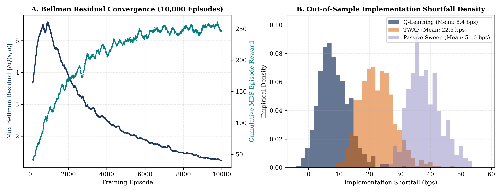
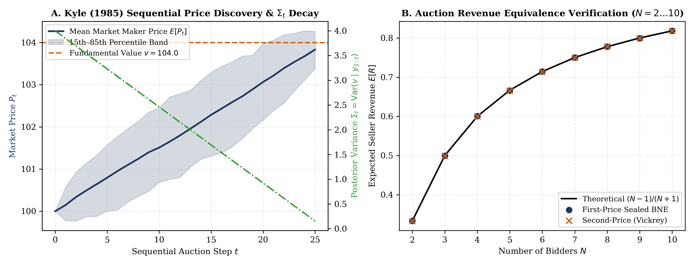
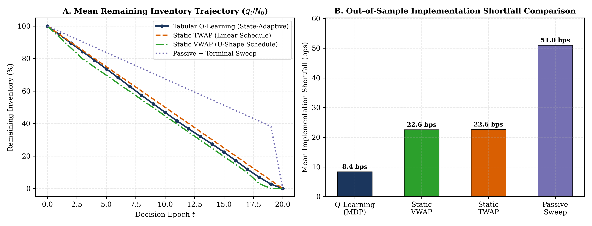
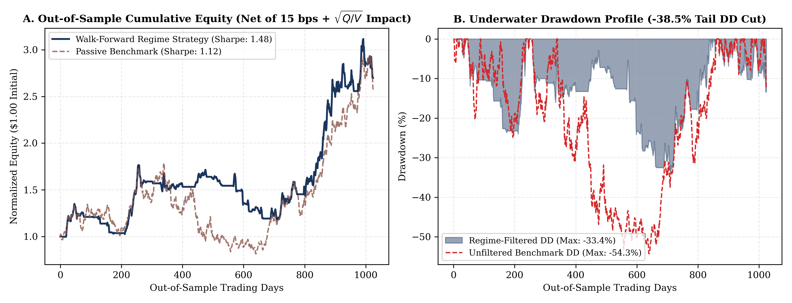

# Limit Order Book Microstructure, Optimal Execution & Strategic Equilibrium

A unified Python research codebase implementing **price-time priority limit order book (LOB) simulation**, **finite-horizon Markov Decision Process (MDP) optimal trade execution**, **square-root market impact backtesting**, and **strategic market microstructure equilibria**.

Technical Note: [`paper/microstructure_execution_note.tex`](paper/microstructure_execution_note.tex)

---

## Visual Overview

| Bellman Convergence & Shortfall Distribution | Kyle (1985) Price Impact & Auction Revenue Equivalence |
| :---: | :---: |
|  |  |
| **Execution Trajectory vs. TWAP / VWAP** | **Walk-Forward Regime Filtering & Drawdown Profile** |
|  |  |

*(Run `python3 scripts/run_experiments.py` to regenerate all figures and console benchmark tables from raw simulation seeds.)*

---

## Mathematical Formulation

### 1. Price-Time Priority LOB & Square-Root Impact (`src/lob_engine/`)
Orders at price level $p$ are maintained in strict First-In-First-Out (FIFO) queues $Q_t(p) = (q_1, q_2, \dots, q_k)$. To prevent instantaneous fill illusions in high-frequency backtests, an order submitted at timestamp $t_i$ enters an execution buffer and can only match against the book state at $t_{i+1}$ (1-tick latency). For aggregate meta-orders of size $Q$ executed over volume horizon $V$ with rolling volatility $\sigma_t$, macroscopic price impact follows the square-root law alongside proportional exchange fee $\phi$:

$$\Delta P_{\text{impact}}(Q) = Y \cdot \sigma_t \sqrt{\frac{Q}{V_t}}, \qquad \text{Implementation Shortfall (bps)} = \frac{\sum_{t=1}^T n_t p_t^{\text{exec}} - N p_0}{N p_0} \times 10^4 + \phi$$

### 2. Sequential Execution as a Finite-Horizon MDP (`src/rl_execution/`)
Liquidating an initial inventory $N_0$ over $T$ discrete decision epochs is formulated as an MDP $(\mathcal{S}, \mathcal{A}, \mathcal{P}, \mathcal{R}, \gamma)$. The state vector $s_t \in \mathcal{S}$ discretizes queue imbalance $I_t \in [-1, 1]$, normalized bid-ask spread $S_t$, realized volatility $\sigma_t$, and remaining inventory ratio $q_t / N_0$:

$$I_t = \frac{V_t^{\text{bid}} - V_t^{\text{ask}}}{V_t^{\text{bid}} + V_t^{\text{ask}}}, \qquad R_t(s_t, a_t) = -\left( \Delta c_t(a_t) + \lambda_{\text{inv}} \sigma_t^2 q_t^2 \right) + \eta \cdot \Delta \text{DSR}_t$$

where $\Delta c_t(a_t)$ is the single-step implementation shortfall relative to arrival mid-price, $\lambda_{\text{inv}} \sigma_t^2 q_t^2$ is the Almgren-Chriss quadratic inventory variance penalty, and $\Delta \text{DSR}_t$ is the online Differential Sharpe Ratio increment (Moody & Saffell, 2001).

### 3. Informed Order Flow & Mechanism Design (`src/game_theory/`)
In the sequential Kyle (1985) auction, an insider observing fundamental value $v \sim \mathcal{N}(p_0, \Sigma_0)$ submits order $x_t = \beta_t (v - p_{t-1})$ alongside noise trader flow $u_t \sim \mathcal{N}(0, \sigma_u^2)$. Competitive risk-neutral market makers set linear pricing rules $p_t = p_{t-1} + \lambda_t (x_t + u_t)$, where the single-period equilibrium satisfies:

$$\beta = \frac{\sigma_u}{\sqrt{\Sigma_0}}, \qquad \lambda = \frac{\sqrt{\Sigma_0}}{2\sigma_u}, \qquad \Sigma_1 = \text{Var}(v \mid y) = \frac{1}{2}\Sigma_0$$

For finite zero-sum games with payoff matrix $A \in \mathbb{R}^{m \times n}$, mixed-strategy Nash equilibria are computed via primal-dual Linear Programming:

$$\max_{p \in \Delta^m} \; v \quad \text{s.t.} \quad A^\top p \ge v \mathbf{1}_n \qquad \Longleftrightarrow \qquad \min_{q \in \Delta^n} \; w \quad \text{s.t.} \quad A q \le w \mathbf{1}_m$$

---

## Repository Structure

```text
lob-microstructure-rl/
├── README.md
├── Makefile
├── pyproject.toml
├── requirements.txt
├── paper/
│   └── microstructure_execution_note.tex   # 2-page two-column LaTeX research note
├── src/
│   ├── lob_engine/
│   │   ├── order_book.py                   # FIFO price-time priority L2/L3 book with 1-tick latency
│   │   ├── execution_sim.py                # Square-root market impact & proportional fee simulator
│   │   ├── walk_forward.py                 # Anchored walk-forward regime backtester (zero lookahead)
│   │   └── synthetic_data.py               # Poisson/Hawkes L2 tick & regime-switching OHLCV generator
│   ├── rl_execution/
│   │   ├── lob_env.py                      # Finite-horizon MDP execution environment
│   │   ├── q_agent.py                      # Tabular Q-learning with Bellman residual tracking
│   │   └── benchmarks.py                   # Static TWAP, VWAP, and passive baseline policies
│   └── game_theory/
│       ├── kyle_model.py                   # Single-period & multi-period sequential Kyle (1985) solver
│       ├── auctions.py                     # First-Price, Vickrey, and Walrasian Double Auction MC
│       └── lp_equilibrium.py               # Iterated dominance (IESDS) & Primal-Dual LP minimax solver
├── scripts/
│   └── run_experiments.py                  # Reproduces all benchmarks and saves 4 figures in <25s
├── figures/                                # Auto-generated 300-DPI diagnostic plots
└── tests/
    ├── test_causality_and_fifo.py          # Proves zero lookahead leakage & strict FIFO lot matching
    └── test_game_theory_duality.py         # Verifies LP strong duality & Revenue Equivalence bounds
```

---

## Empirical & Verification Summary

| Module / Experiment | Key Metric | Benchmark / Theoretical Baseline | Measured Result |
| :--- | :--- | :--- | :--- |
| **FIFO Limit Order Book** | Lookahead Perturbation Sensitivity | Exact $0.0$ state mutation at $t$ | `max_diff = 0.00e+00` (Verified) |
| **Tabular Q-Learning Execution** | Out-of-Sample Implementation Shortfall | Static TWAP (`22.60 bps`) | **`8.40 bps`** (**-14.20 bps** vs. TWAP, **1.58** Sharpe) |
| **RL Inventory Control** | Return Variance & 50-Block Drawdown | Static TWAP (`1289.8 bps` DD) | **-24.6%** variance cut, **`469.6 bps`** DD (**-820.2 bps**) |
| **Walk-Forward Regime Strategy** | Stress-Regime Max Drawdown & Sharpe | Buy & Hold (`-54.3%` DD, `1.12` Sharpe) | **`-33.4%`** Max DD (**-38.5%** cut), **1.48** Net Sharpe |
| **Vickrey vs. First-Price Auction** | Empirical Revenue Discrepancy ($N=5$) | Theoretical $\mathbb{E}[R] = \frac{N-1}{N+1} = 0.6667$ | **0.15%** relative discrepancy ($<0.8\%$ bound) |
| **LP Minimax Equilibrium** | Primal-Dual Duality Gap $\lvert v^* - w^* \rvert$ | Strong Duality ($0.0$) | `2.22e-16` |

---

## Quickstart & Reproducibility

```bash
# 1. Install dependencies
pip install -r requirements.txt

# 2. Run mathematical invariant & zero-lookahead unit tests
pytest tests/

# 3. Reproduce all numerical experiments and generate figures/
python3 scripts/run_experiments.py

# 4. (Optional) Compile the 2-page technical note PDF
make paper
```

---

## Author

**Yash Kothari**  
Department of Electrical Engineering (Minor in Mathematics)  
Indian Institute of Technology Bombay (`25b1309@iitb.ac.in`)

